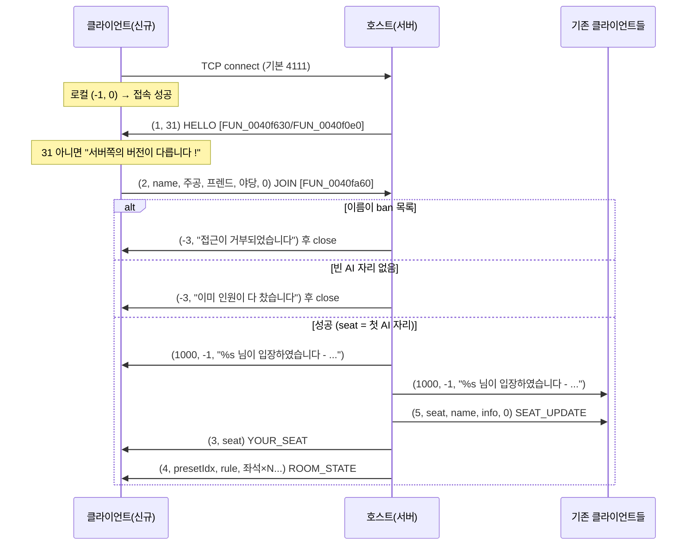
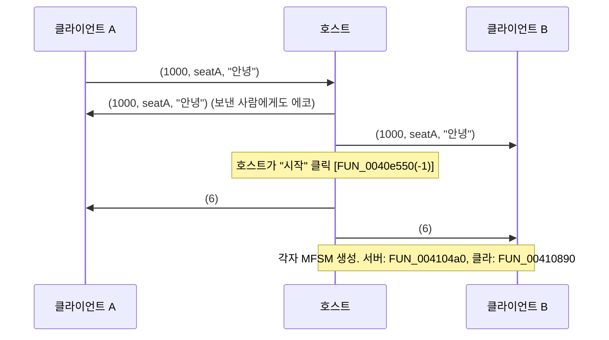
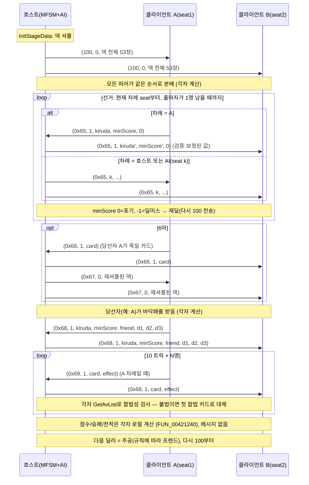
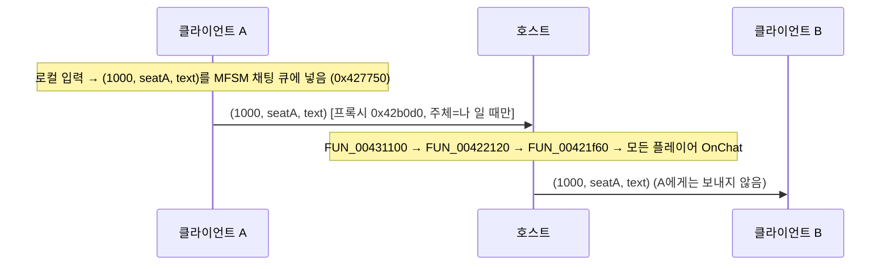
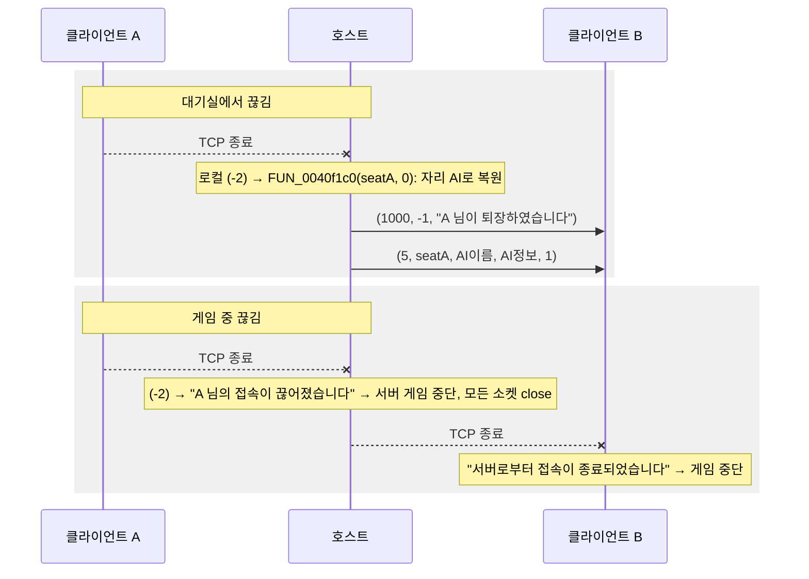

# 마이티 네트워크 3.2 — TCP/IP 멀티플레이 프로토콜 분석

> 대상: `Mighty.exe` (MFC42, Win32, 2000년, 장문성)
> 근거: Ghidra 디컴파일(`decompiled/Mighty.exe.annotated.c`) + `objdump -d` 디스어셈블리(Ghidra가 가변인자(varargs)를 누락한 부분은 디스어셈블리로 직접 확인)
> 표기: `FUN_xxxxxxxx` = 함수 주소, `+0xNN` = 객체 내 오프셋, `l`/`s`/`C` = 직렬화 포맷 문자

---

## 0. 한눈에 보기

| 항목 | 내용 |
|---|---|
| 토폴로지 | **호스트(딜러)가 서버를 내장**한 스타형. 클라이언트끼리 직접 통신하지 않음 |
| 전송 | TCP, 기본 포트 **4111**(0x100F, 레지스트리 `Communication\Port`) |
| 프레이밍 | `[int32 L][int32 L][페이로드 L-4 바이트]` — 길이 필드가 **두 번** 나감, little-endian, `htonl` 없음 |
| 페이로드 | 첫 int32 = 메시지 타입, 나머지는 포맷 문자열(`l`=int32, `s`=NUL 종료 문자열(CP949), `C`=카드리스트) |
| 버전 | 서버 hello `(1, 31)` — 31(0x1F)이 아니면 클라이언트가 `서버쪽의 버전이 다릅니다 !` |
| 인원 | 좌석 최대 6개(0번=호스트). 실제 인원은 규칙(3마~6마)의 플레이어 수. 원격 접속은 최대 5명 |
| 게임 동기화 | **락스텝 이벤트 복제**. 모든 피어가 같은 상태 기계(MFSM)를 돌리며, 서버는 셔플한 **덱 전체**와 각 플레이어의 "결정"(공약, 당선 공약/버린 카드, 6마 죽이기, 카드 내기, 채팅)만 중계 |
| 보안 | 사실상 없음. 클라이언트가 덱 전체(모든 손패+바닥패)를 받음. 체크섬/인증 없음 |

---

## 1. 아키텍처

### 1.1 역할 구성

메인 메뉴(`FUN_0041aed0` 근방의 점프테이블)에서:

- **"여기서 하기" / "딜러가 되어 다른 사용자의 접속을 기다립니다"** → 대기실 객체 생성 `FUN_0040d5a0` 후 `FUN_0040d970(this, NULL)` 호출 → **서버 모드**(`+0x84 = 1`).
- **"다른 딜러에게 접속합니다" / "다른곳으로 접속"** → 접속 대화상자(vtable `0x437d34`/`0x438550`, 코드 `0x40cbd0~0x40d060`) → 주소 입력 `"주소(:포트번호)"` 파싱(`FUN_0040d120`: `:` 뒤를 `atoi`, 없으면 설정 포트) → 소켓 생성 후 `connect`.
- **"Mighty.Net 에 접속합니다"** → 레지스트리 `MightyNet` 주소로 접속하는 메뉴로 보이나 별도 프로토콜 흔적은 없음(불확실, §9).

접속 주소 MRU: 레지스트리 `Communication\Address`, `Addr0..Addr3` (`FUN_004254e0`/`FUN_00425c80`, 갱신 `FUN_0040d500`).

### 1.2 소켓 계층 (자체 구현, MFC `CAsyncSocket` 미사용)

| 클래스(추정명) | 생성자 / vtable | 역할 |
|---|---|---|
| `CSocketBase` | `FUN_00431fb0` / `0x43a884` | WinSock 래퍼 + **소켓당 전용 워커 스레드** |
| `CMsgSocket` | `FUN_0042b180` / `0x439194` | 메시지 단위 송수신, 수신 큐 + 1회성 콜백 |
| `CMsg` | `FUN_004250c0` / `0x438ed8` | 직렬화 버퍼 (§2) |
| 대기실 리슨 소켓 | 대기실 `+0x5c`, vtable `0x437d68` | `OnAccept` → `FUN_0040f630` |

`CSocketBase` 주요 함수:

- `FUN_00432090` : `socket(AF_INET, type)` + `bind(INADDR_ANY:port)` + (스트림이면) `listen(backlog=5)` → 상태 `+0x14 = 1(listening)` 후 스레드 시작.
- `FUN_00432120` : connect 준비, 상태 2(connecting) 후 스레드 시작. 실제 connect는 스레드에서 `FUN_00432550`(non-blocking `ioctlsocket(FIONBIO)` + `select` 1초 폴링).
- `FUN_004321b0` : `accept` → 새 소켓 상태 3(connected).
- `FUN_00432640` : `AfxBeginThread(LAB_00432680)` — 워커 스레드.
- 워커 스레드(`0x432690`, 디스어셈블리로 확인): `select(timeout=1000ms)` 루프
  - 상태 1 & readable → `vtable+0x08` (OnAccept)
  - 상태 2 → connect 결과로 `vtable+0x0C(err)` (OnConnect)
  - 상태 3 & readable → `vtable+0x10` (OnReceive)
- `FUN_004322f0` : send-all (WSAEWOULDBLOCK/EINPROGRESS면 `Sleep(1000)` 후 재시도). **송신은 호출 스레드에서 동기(blocking)**.
- `FUN_004323a0` : recv-all (동일 방식).
- `FUN_00431e40` : `sockaddr_in` 구성 (`inet_addr` 실패 시 `gethostbyname`).
- `FUN_00431f10` / `FUN_0040deb0` : `gethostname`으로 자기 호스트명 → 대기실 제목 `"%s:%u"`(`FUN_0040d970`).

`CMsgSocket` (vtable `0x439194`):

| 슬롯 | 함수 | 동작 |
|---|---|---|
| +0x04 Close | `FUN_0042b620` | `closesocket` 후 **로컬 의사 메시지 `(-2)`** 를 수신 큐에 넣음 |
| +0x0C OnConnect | `FUN_0042b6a0` | 로컬 의사 메시지 `(-1, err)` 를 큐에 넣음 |
| +0x10 OnReceive | `0x42b710` | `recv 4바이트(L)` → `CMsg` 생성 → `FUN_004251f0(L)` → `recv L바이트` → 큐 삽입(`FUN_0042b490`). recv 실패 시 Close |
| — | `FUN_0042b850` | 송신: `send(&L,4)` 후 `send(buffer,L)` |
| — | `FUN_0042b340(sock, obj, param, fn)` | **1회성 콜백 등록**. 큐에 이미 메시지가 있으면 즉시 꺼내서 호출 예약 |
| — | `FUN_0042b3f0` | 콜백 호출 예약: 내부 메시지 `"llllll"(10000, …)`를 만들어 메인 윈도에 `PostMessage(WM_USER+0x0E = 0x40E)` |

즉 **소켓 스레드 → 큐 → UI 스레드(PostMessage 0x40E) → 핸들러**. 핸들러는 처리 후 매번 `FUN_0042b340`으로 콜백을 재등록한다(재등록하지 않으면 다음 메시지가 큐에 쌓이기만 함).

게임 중에는 별도의 **게임 상태 기계 스레드**(`FUN_00421df0` → `AfxBeginThread(LAB_00421e40)`, 본체 `FUN_004225b0`)가 돌며, `CEvent`/`CMultiLock`로 플레이어 응답을 기다린다(`FUN_004223e0`, `FUN_004224f0`).

### 1.3 좌석/플레이어 모델

대기실 객체(`FUN_0040d5a0`, 크기 0x1F8)의 좌석 배열: `+0xE0 + seat*0x20` (6개)

| 오프셋(좌석 기준) | 의미 |
|---|---|
| +0x00 (`0xE0`) | 이름 `CString` |
| +0x04 (`0xE4`) | 정보 문자열: 사람이면 `"%d/%d %d/%d %d/%d"`(전적, `FUN_0040de00`), AI면 DLL 파일명 또는 `<기본 AI>` (`FUN_0040ed30`) |
| +0x08 (`0xE8`) | 주공 전적 (packed: 하위16비트=승, 상위16비트=패) |
| +0x0C (`0xEC`) | 프렌드 전적 (packed) |
| +0x10 (`0xF0`) | 야당 전적 (packed) |
| +0x14 (`0xF4`) | 시작 점수(지지율/비자금), 항상 100 |
| +0x18 (`0xF8`) | isComputer 플래그 (1=AI 자리, 빈 자리) |
| +0x1C (`0xFC`) | 해당 좌석의 `CMsgSocket*` (서버측) |

- 좌석 0 = 호스트. 좌석 1..5는 기본적으로 AI(`FUN_0040ec20`, 이름은 레지스트리 `Player%d`).
- 원격 접속자는 **AI 자리 중 첫 번째**를 차지(`FUN_0040f240`). 빈 AI 자리가 없으면 거절.
- 대기실 기타: `+0x88` 클라이언트의 서버 소켓, `+0x8C` 내 좌석 번호, `+0x90` 제목, `+0x94` 규칙 이름, `+0x98` 규칙(CState 규칙 블록, 첫 int = 인원수), `+0x1DC` **추방(ban) 이름 목록**(`CStringList`).

### 1.4 게임 시작 후 플레이어 객체

공통 인터페이스 `CPlayer`(vtable `0x438f40`)의 구현:

| 종류 | 생성자 / vtable | 어디서 |
|---|---|---|
| 로컬 사람 | `FUN_004266b0` / `0x438edc` | 각 피어의 자기 자신(로컬 인덱스 0) |
| AI(MAI DLL) | `FUN_00429570` / `0x4390a8` | **호스트에서만** — AI 좌석 |
| 네트워크 프록시 | `FUN_0042a2c0` / `0x439130` | 서버: 원격 사람 좌석 / 클라이언트: **자기 외 모든 좌석**(호스트·AI 포함) |

- 서버 시작 `FUN_004104a0`, 클라이언트 시작 `FUN_00410890`.
- 클라이언트는 좌석을 회전시켜 로컬 인덱스 0이 자기가 되도록 배치: 로컬 i ↔ 절대 좌석 `(mySeat + i) % N` (`FUN_00420a70` 로컬→절대, `FUN_00420aa0` 절대→로컬, MFSM `+0x120` = mySeat). **와이어에는 항상 절대 좌석 번호**가 실린다.
- 통신 라우터 `FUN_00430d00`(vtable `0x43a880`, MFSM `+0x174`): 좌석별 슬롯(0x2C) = {좌석, 소켓, 수신 큐, 대기자}. 서버는 원격 좌석마다 소켓(`FUN_00430fb0`), 클라이언트는 서버 소켓 하나(`FUN_00430f90`, `+4`)를 두고 **메시지 2번째 필드(좌석)로 디멀티플렉스**(`FUN_00431100`).
- **AI는 호스트에서만 실행**. 클라이언트에게 AI 좌석은 그냥 "원격 플레이어"이며 AI 결정도 서버가 중계한다.

### 1.5 재접속 / 추방

- **재접속 없음.** 게임 중 소켓 끊김/송신 실패/순서 어긋난 메시지는 해당 피어의 게임 전체를 중단시킨다(`FUN_0042a4c0` → `FUN_004220f0` → 모든 플레이어 abort, 예외로 상태기계 종료). AI 대체도 없음.
  - 서버측 문구: `"%s 님의 접속이 끊어졌습니다"`(0x442b90), `" 님에게 이상이 발생했습니다"`(0x442b74)
  - 클라이언트측: `"서버로부터 접속이 종료되었습니다"`(0x442b50), `"서버에 이상이 발생했습니다"`(0x442b34), `"서버로부터 예상치 못한 응답이 도착했습니다"`(0x442454)
- 게임 도중 신규 접속 불가: 게임 시작 시 대기실 객체가 파괴되며 리슨 소켓도 닫힘(`FUN_0040d7c0`).
- **추방(대기실에서만, 호스트 UI)**: `FUN_0040e550`에서 버튼 ID `200 + seat*10 + k`
  - `k=1` "이 플레이어를 추방" → `FUN_0040f1c0(seat, kick=1)`
  - `k=2` "이 게임에서 영구적으로 추방" → 이름을 ban 목록(`+0x1E0` 리스트)에 추가 후 동일 처리
  - 처리(`FUN_0040f4c0`): 대상에게 `(-3, "게임에서 추방당했습니다 !!")` 송신 → 소켓 닫기 → 자리를 AI로 복원(`FUN_0040ec20`) → 전체에 시스템 채팅 `"%s 님이 게임에서 추방당했습니다 !!"` + 좌석 갱신(5) 브로드캐스트
  - "영구" 추방은 **이름 문자열 비교**(`_mbscmp`)만 하며 대기실 객체 수명 동안만 유효(저장 안 됨).

---

## 2. 와이어 프레이밍과 직렬화

### 2.1 CMsg 버퍼 (`FUN_004250c0`, `FUN_00425090`)

```
CMsg (0x18 bytes)
 +0x00 vtable 0x438ed8
 +0x04 capacity (초기 0x40, 64바이트 단위 realloc: FUN_00425450)
 +0x08 buffer*
 +0x0C header* (= buffer, 첫 dword = 전체 길이 L, 자기 자신 4바이트 포함. 초기값 4)
 +0x10 write ptr
 +0x14 read ptr (초기 buffer+4)
```

### 2.2 포맷 문자 (`FUN_004250c0`의 switch)

| 문자 | 쓰기 함수 | 읽기 함수 | 인코딩 |
|---|---|---|---|
| `l` | `FUN_00425260` | `FUN_00425330` | int32 **little-endian, 원시 메모리 복사**(바이트오더 변환 없음), 정렬 패딩 없음 |
| `s` | `FUN_004252a0` (`char*`) | `FUN_00425360` | NUL 종료 바이트열. 길이 접두사 없음. 실제로는 **CP949(ANSI 코드페이지)** |
| `S` | `FUN_004252a0` (`CString*` 역참조) | `FUN_00425360` | `s`와 동일 |
| `C` | `FUN_00425300` | `FUN_004253a0` | `CCardList`: `l count` + `l card` × count |
| `k` | `FUN_00425230` | (`FUN_00425220` = **빈 함수**) | 체크섬 `0x55555555 + Σ(signed char)payload` 를 `l`로 추가. 이 버전에서 **사용처 없음, 검증도 안 함** |

### 2.3 와이어 형식 (`FUN_0042b850` 송신, `0x42b710` 수신)

```
offset 0 : int32 L           ← send(&L, 4)
offset 4 : int32 L           ← send(buffer, L) 의 첫 4바이트 (버퍼 헤더)
offset 8 : int32 type
offset 12: 필드들 ...         (총 L-4 바이트가 헤더 뒤에 옴)
총 바이트 = 4 + L
```

예) hello `(1, 31)`:
```
0C 00 00 00  0C 00 00 00  01 00 00 00  1F 00 00 00
```

- 수신측은 앞 4바이트로 L을 읽고 L바이트를 버퍼에 그대로 받는다(두 번째 L이 버퍼 헤더를 덮어씀).
- **최대 길이 제한 없음**(L을 그대로 realloc) → 웹 버전에서는 반드시 상한을 둘 것.
- 메시지 처리 코드는 공통으로 `L > 7`(= type 필드 존재)인지 확인 후 `buffer+4`의 type으로 분기.
- 읽기 실패(필드 부족)는 대부분 "예상치 못한 응답"/에러 처리.

### 2.4 카드 인코딩 (`CCard`, `0x401220~0x4014e0`, export 이름으로 확인)

| 값 | 의미 |
|---|---|
| 0 | 없음(`IsNothing`) |
| 1..13 | 스페이드 A,2..10,J,Q,K |
| 14..26 | 다이아몬드 A..K |
| 27..39 | 하트 A..K |
| 40..52 | 클로버 A..K |
| 53 (0x35) | 조커(`GetJoker`) — 범위 밖 값도 생성자에서 53으로 강제됨 |

- `card = (suit-1)*13 + rank` (`CCard(int,int)` @ `0x401250`), suit: 1=스페이드(삽), 2=다이아(다리), 3=하트(트), 4=클로버(끌) (문자열표 `0x441128`).
- 기루다(kiruda) 값: 0 = 노기루다, 1..4 = 위 suit.
- 수신 코드는 카드 값이 `<0 || >52`이면 53으로 바꾼다(예: `FUN_0042a910`, `FUN_0042aba0`).

### 2.5 규칙 문자열 (`FUN_004306a0` 인코드, `FUN_00430a10` 디코드)

14자 ASCII. 각 문자 = `값 + '#'(0x23)`.

- `c[0]` = 인원수, `c[1]` = 규칙 `+0x08` 정수, `c[2..5]` = `+0x38/+0x3C/+0x40/+0x44` 정수
- `c[6..13]` = 6비트 플래그 묶음(각 비트가 규칙 bool 하나; `+0x0C,+0x0D,+0x04,+0x0E..+0x37`)
- 프리셋 12개: 표 `0x442e5c` (문자열, 이름) 쌍 — `"표준 3마/4마/5마/6마"`, `"관악 6마"`, `"신촌 5마"`, `"경기 5마"`, `"부산 4마"`, `"대구 5마"`, `"대전 6마"`, `"광주 5마"`, `"제주 3마"` 등. `FUN_00430670(idx)`로 로드.
- 각 필드의 정확한 의미는 규칙 대화상자(PRule*) 분석이 필요(별도 문서 범위).

---

## 3. 메시지 카탈로그

방향: **S→C** 서버→클라이언트, **C→S** 클라이언트→서버, **S⇉C** 서버 중계(브로드캐스트).
"좌석"은 항상 **절대 좌석 번호**(0=호스트).

### 3.1 로컬 의사 메시지 (와이어에 안 나감)

| type | 포맷 | 생성 | 의미 |
|---|---|---|---|
| -1 | `ll` (-1, wsaErr) | `FUN_0042b6a0` | connect 결과. err==0 성공 |
| -2 | `l` (-2) | `FUN_0042b620` | 소켓 닫힘/recv 실패 |
| 10000 | `llllll` | `FUN_0042b3f0` | UI 스레드 콜백 디스패치(PostMessage 0x40E) |

### 3.2 대기실(로비) 단계

| type | 방향 | 포맷 / 필드 | 생성 → 처리 |
|---|---|---|---|
| **1** HELLO | S→C | `ll` : `1, version=31` | `FUN_0040f0e0` (accept 직후 `FUN_0040f630`) → `FUN_0040d2e0` (31 아니면 버전 오류) |
| **2** JOIN | C→S | `lsllll` : `2, name, stat주공, stat프렌드, stat야당, 0` | `FUN_0040fa60` (`FUN_0040d970` 클라이언트 분기) → `FUN_0040f770`/`FUN_0040f240` |
| **3** YOUR_SEAT | S→C | `ll` : `3, seat` | `FUN_0040f150` → `FUN_0040fb00` (대기실 `+0x8C` = seat) |
| **4** ROOM_STATE | S→C | `lls` + `sslllll`×N : `4, presetIdx, ruleStr` 그리고 좌석 0..N-1마다 `name, info, isComputer, stat주공, stat프렌드, stat야당, money(100)` | `FUN_0040ede0` → `FUN_0040fb40` |
| **5** SEAT_UPDATE | S⇉C | `llssl` : `5, seat, name, info, isComputer` | `FUN_0040f050` → `FUN_0040fd60` |
| **6** GAME_START | S⇉C | `l` : `6` | `FUN_0040e550(-1)`("시작" 버튼, 서버만) → 클라 `FUN_0040ff00` → `FUN_00410890` |
| **1000** CHAT | C→S, S⇉C | `lls` : `1000, seat, text` (seat=-1 이면 시스템 메시지) | `FUN_0040eba0` / `FUN_00410120` → 서버 `FUN_0040fe30`+재브로드캐스트, 클라 `FUN_0040fe30` |
| **-3** ERROR | S→C | `ls` : `-3, text` | `FUN_0040f770`, `FUN_0040f4c0` → 클라 `FUN_0040d2e0`/`FUN_0040ff00`: `"서버로부터 에러코드가 수신되었습니다 !"`+text 표시 후 종료 |

필드 상세:

- **stat (packed int32)**: `wins | (losses << 16)`. 승률 = `Σwins*100 / Σ(wins+losses)` (`FUN_0040df00`). 호스트 자신 값은 앱 `+0x1B8/+0x1BC/+0x1C0`.
- **ROOM_STATE.presetIdx / ruleStr**: 호스트의 프리셋 번호(앱 `+0x120`).
  - `presetIdx == 0`(사용자정의) → `ruleStr` = §2.5 인코딩된 규칙 문자열. 클라는 `FUN_00430a10`으로 디코드, 이름은 `"사용자정의"`.
  - `presetIdx != 0` → `ruleStr` = 프리셋 **이름**. 클라는 `FUN_00430670(presetIdx)`로 규칙을 로드하고 받은 문자열을 이름으로 사용.
  - N = 규칙의 인원수(클라는 규칙을 먼저 적용한 뒤 그 인원수만큼 좌석을 읽음). 송신측은 항상 6좌석분 인자를 push하지만 포맷 문자열이 N개만 소비.
- **-3 텍스트**: `"이미 인원이 다 찼습니다"`(0x4415d4, 빈 AI 자리 없음), `"접근이 거부되었습니다"`(0x4415bc, ban 목록 이름), `"게임에서 추방당했습니다 !!"`(0x4415a0, 추방).
- **시스템 채팅(1000, -1, …)** 문구: 입장 `"%s 님이 입장하였습니다 - 주공:%d승%d패 프랜드:%d승%d패 야당:%d승%d패 승률:%d%%"`, 퇴장 `"%s 님이 퇴장하였습니다"`, 추방 `"%s 님이 게임에서 추방당했습니다 !!"`.

서버 대기실 상태 머신(`FUN_0040f770`, 콜백 파라미터 = 좌석, 0이면 미가입):

- 미가입 연결: `2`만 처리, `-2`면 소켓 삭제, 그 외 무시.
- 가입 좌석: `1000` → 표시 + **모든 사람 좌석에 재전송(보낸 사람 포함)**(`FUN_0040ed90(msg, -1)`), `-2` → 퇴장 처리(`FUN_0040f1c0(seat,0)`), 그 외 무시.
- 브로드캐스트 `FUN_0040ed90(msg, except)`: 좌석 1..5 중 사람 좌석에 송신, 실패 시 그 좌석 퇴장 처리.

### 3.3 게임 단계 (락스텝 이벤트)

게임 메시지는 전부 네트워크 프록시 `CPlayerNetwork`(vtable `0x439130`)에서만 송수신된다.
송신 규칙(모든 notify 함수 공통, 예: `0x42a850`):

- **서버**(MFSM `+0x120 == 0`): 이벤트 주체 좌석 ≠ 이 프록시의 좌석이면 그 원격에 송신 → 결과적으로 **주체를 제외한 모든 원격에 중계**.
- **클라이언트**: 이 프록시가 서버(절대 좌석 0)이고 주체가 로컬 0(=나)일 때만 송신 → **내 결정만 서버로 1회 송신**.

수신 규칙(ask 함수, 예: `FUN_0042a700`): 해당 좌석 슬롯에서 메시지를 기다려(`FUN_00431000`) **type과 좌석이 기대값과 정확히 일치**해야 함. 아니면 `FUN_0042a4c0(3)` → 게임 중단.

| type | 방향 | 포맷 / 필드 | 송신(notify) | 수신(ask) |
|---|---|---|---|---|
| **100 (0x64)** DECK | S→C | `llC` : `100, 0, deck` | `0x42a670` (vt[14]=+0x38, 서버만) | `FUN_00422210` (MFSM, 슬롯 0) |
| **101 (0x65)** BID | C→S, S⇉C | `lllll` : `0x65, seat, kiruda, minScore, 0` | `0x42a850` (vt[16]=+0x40) | `FUN_0042a700` (vt[7]=+0x1C) — 3값을 goal{kiruda,minScore,friend}로 읽음 |
| **102 (0x66)** KILL (6마) | C→S, S⇉C | `lll` : `0x66, presidentSeat, card` | `0x42aa40` (vt[5]=+0x14) | `FUN_0042a910` (vt[6]=+0x18) |
| **103 (0x67)** DECK_RESYNC | S→C | `llC` : `0x67, 0, deck` | `0x42ab10` (vt[17]=+0x44, 서버만) | `FUN_00422210` (100/0x67 둘 다 허용) |
| **104 (0x68)** ELECTED | C→S, S⇉C | `llllllll` : `0x68, seat, kiruda, minScore, friend, drop1, drop2, drop3` | `0x42ada0` (vt[18]=+0x48) | `FUN_0042aba0` (vt[9]=+0x24) |
| **105 (0x69)** PLAY | C→S, S⇉C | `llll` : `0x69, seat, card, effect` | `0x42b000` (vt[11]=+0x2C) | `FUN_0042aec0` (vt[12]=+0x30) |
| **1000** CHAT | C→S, S⇉C | `lls` : `1000, seat, text` | `0x42b0d0` (OnChat, vt+0x60) | `FUN_00431100` 가로채서 MFSM 채팅 큐(`FUN_00422120` → `FUN_00421f60`) |
| **-3** ERROR | S→C | `ls` : `-3, text` | — | `FUN_00431100` → 게임 중단 + 메시지 |

필드 의미:

- **BID minScore**: `0` = 출마 포기(패스), `-1` = **딜 미스 선언**(`FUN_00420d10`), 양수 = 목표 점수. notify는 MFSM이 `CState::IsValidNewGoal`로 **보정한 값**을 보냄(유효하지 않으면 minScore=0 등으로 바뀜).
- **ELECTED friend**: `0` = 노프렌드, `100` = 초구 프렌드, `1..53` = 카드 프렌드(그 카드를 가진 사람), **음수** = 플레이어 지명 `-1 - 절대좌석` (수신 시 `FUN_00420b30`/`FUN_00420b50`으로 로컬 인덱스 변환). `drop1..3` = 당선자가 버린 3장(바닥패 포함 13장 → 10장).
- **PLAY effect** (`FUN_004211c0`):
  - 카드가 조커콜 카드이고 조커콜이 유효한 상황이면 `effect != 0` = 조커콜 선언.
  - 카드가 조커(53)이고 그 턴의 선(先)이면 `effect` = 요구 무늬 1..4(범위 밖이면 1).
  - 그 외 무시.
- **KILL card**: 당선자가 지목한 카드. 그 카드를 가진 플레이어가 죽고(그 패는 덱으로 회수, 재셔플 → 0x67), 아무도 없으면 실패 목록에 넣고 다시 고름.
- **DECK**: 서버가 `CState::InitStageData`에서 셔플한 덱(MFSM `+0x28`) **전체**. 클라이언트는 받은 리스트로 자기 덱을 덮어쓰고(개수가 다르면 오류), 이후 분배는 각자 동일한 결정론적 순서로 수행.

#### CPlayer 가상함수 ↔ 메시지 매핑 (참고: MAI 인터페이스 이름은 추정)

기본 `CPlayer`(vtable `0x438f40`)는 이벤트를 `+0x88`의 AI 인터페이스(CPlay)로 위임한다(`0x4269e0~0x426af0`). MFSM 호출 순서(`FUN_004225b0`)와 맞춰 본 의미:

| vtable 오프셋 | 추정 이름 | 성격 | 네트워크 프록시 구현 | 메시지 |
|---|---|---|---|---|
| +0x10 | OnBegin | 알림 | 기본 | — |
| +0x14 | (6마) 죽은 카드 알림 | 알림 | `0x42aa40` | 0x66 송신 |
| +0x18 | OnKillOneFromSix | 질의 | `FUN_0042a910` | 0x66 수신 |
| +0x1C | OnElection(공약) | 질의 | `FUN_0042a700` | 0x65 수신 |
| +0x20 | 선거 종료/당선자 확정 | 알림 | 기본 | — |
| +0x24 | OnElected(최종 공약+버릴 3장) | 질의 | `FUN_0042aba0` | 0x68 수신 |
| +0x28 | OnElectionEnd(본게임 시작) | 알림 | 기본 | — |
| +0x2C | 카드 낸 것 알림 | 알림 | `0x42b000` | 0x69 송신 |
| +0x30 | OnTurn(카드 내기) | 질의 | `FUN_0042aec0` | 0x69 수신 |
| +0x34 | OnTurnEnd(트릭 종료) | 알림 | 기본 | — |
| +0x38 | 딜 시작(덱 동기화) | 알림 | `0x42a670` | 100 송신(서버만) |
| +0x3C | 카드 한 장 분배됨 | 알림 | 기본 | — |
| +0x40 | 다른 사람 공약 알림(OnElecting) | 알림 | `0x42a850` | 0x65 송신 |
| +0x44 | 6마 재셔플 | 알림 | `0x42ab10` | 0x67 송신(서버만) |
| +0x48 | 당선 공약/버린 카드 알림 | 알림 | `0x42ada0` | 0x68 송신 |
| +0x4C / +0x50 | 점수카드 획득 / 프렌드 공개 등 | 알림 | 기본 | — |
| +0x54 | OnEnd(판 종료, 계속 여부) | 알림 | 기본 `0x426970` = 항상 계속 | — |
| +0x58 | 차례 변경 표시 | 알림 | 기본 | — |
| +0x5C | 중단(abort, 메시지) | 알림 | — | — |
| +0x60 | OnChat | 알림 | `0x42b0d0` | 1000 송신 |

---

## 4. 시퀀스 다이어그램

### 4.1 대기실 입장



### 4.2 대기실 채팅 / 게임 시작



### 4.3 한 판(딜 → 선거 → 당선/버리기 → 10트릭 → 정산)



### 4.4 게임 중 채팅



### 4.5 연결 끊김



---

## 5. 신뢰 모델 (웹 버전 설계에 중요)

1. **클라이언트가 모든 카드를 안다.** 서버는 매 딜마다 셔플된 덱 전체(`llC`, 53장)를 모든 클라이언트에 보낸다(`0x42a670`, `0x42ab10` → `FUN_00422210`). 분배·바닥패·6마 재분배를 클라이언트가 직접 계산하므로 메모리/패킷만 보면 남의 패와 바닥패가 다 보인다. (참고: 동봉 AI 설명에도 "이 알고리즘은 다른 사람의 패를 모두 읽을 수 있다"는 문구가 있음.)
2. **완전 락스텝 + 로컬 검증.** 서버는 "권위 서버"가 아니라 중계자 + 셔플러다. 각 피어가 같은 MFSM(`FUN_004225b0`)으로 규칙 검증(`IsValidNewGoal`, `GetValidFriend`, `GetAvList`)을 하고 결과(점수·승패·지지율)를 각자 계산한다. 불법 카드는 결정론적으로 "첫 합법 카드"로 대체되므로 모든 피어 결과가 같다.
3. **식별/인증 없음.** 좌석 식별은 소켓 기반이지만, 채팅(1000)의 좌석 필드는 검증하지 않고 그대로 중계(로비 `FUN_0040fe30`, 게임 `FUN_00421f60`) → 발신자 위조 가능. 이름 중복 허용, ban은 이름 문자열만 비교.
4. **딜미스 선언(minScore=-1)** 이 손패 조건(`CState::IsDealMiss`)을 MFSM 단계에서 다시 검사하는지는 확인 못 함(§9) → 조작 클라이언트가 임의로 재딜을 유발할 수 있을 가능성.
5. **입력 견고성 낮음.** 길이 상한 없음(메모리 DoS), 체크섬 미검증, 순서가 어긋난 메시지 하나로 게임 전체 중단.
6. **전적은 자기 신고.** JOIN의 승/패 값은 클라이언트 레지스트리 값을 그대로 보냄.

### 웹 버전 권장

- **서버 권위(authoritative) 모델**로 바꾼다: 덱/손패/바닥패는 서버만 보유, 각 클라이언트에는 **자기 손패**와 공개 정보(낸 카드, 공약, 공개된 프렌드 등)만 보낸다.
- 원본의 메시지 단위(BID/KILL/ELECTED/PLAY/CHAT)는 그대로 "클라이언트 → 서버 의도(intent)"로 쓰고, 서버는 검증 후 브로드캐스트 이벤트로 재구성한다. DECK(100/0x67)는 `DEAL{myHand}` + 당선자 전용 `KITTY{cards}`로 대체.
- 채팅의 발신 좌석은 서버가 연결 정보로 채운다.
- AI 좌석은 서버에서 실행(원본과 동일). 끊긴 플레이어는 AI로 대체하고 재접속 토큰을 두는 것을 권장(원본에는 없음).
- 와이어 호환이 필요 없다면 JSON 메시지 권장. 호환이 필요하면 §2의 바이너리 형식(length 2회, LE int32, CP949 NUL 종료 문자열)을 그대로 구현.

---

## 6. 웹 포팅용 메시지 스키마 제안 (원본 → JSON 대응)

| 원본 | 제안 JSON | 비고 |
|---|---|---|
| 1 HELLO | `{t:"hello", version:31}` | |
| 2 JOIN | `{t:"join", name, stats:{president:[w,l], friend:[w,l], opposition:[w,l]}}` | |
| 3 / 4 | `{t:"room", mySeat, preset, rule, seats:[{name, info, isAI, stats, money}]}` | 3과 4를 합쳐도 됨 |
| 5 | `{t:"seat", seat, name, info, isAI}` | |
| 6 | `{t:"start"}` | |
| 100 / 0x67 | `{t:"deal", hand:[...]}` (+ 당선자에게만 `{t:"kitty", cards}`) | **덱 전체 전송 금지** |
| 0x65 | C→S `{t:"bid", kiruda, minScore}` / S⇉C `{t:"bid", seat, kiruda, minScore}` | 0=패스, -1=딜미스(서버가 IsDealMiss 검증) |
| 0x66 | `{t:"kill", seat, card}` + 결과 `{t:"killed", victimSeat|null}` | |
| 0x68 | `{t:"elected", seat, kiruda, minScore, friend}` / 버린 카드는 당선자↔서버만 | 버린 카드 공개 여부는 원작 UI 확인 필요 |
| 0x69 | `{t:"play", seat, card, effect}` | 서버가 GetAvList 검증, 불법이면 거부 |
| 1000 | `{t:"chat", seat, text}` | seat은 서버가 채움, -1=시스템 |
| -3 | `{t:"error", text}` | 거절/추방 |

---

## 7. 주요 함수 색인

| 주소 | 역할 |
|---|---|
| `FUN_00431e40` | sockaddr 구성(inet_addr/gethostbyname) |
| `FUN_00431fb0`, `FUN_00432020` | 소켓 기본 객체 생성/닫기(스레드 종료 대기) |
| `FUN_00432090` | socket+bind(+listen 5) |
| `FUN_00432120`, `FUN_00432550` | connect(비동기, select 폴링) |
| `FUN_004321b0` | accept |
| `FUN_004322f0` / `FUN_004323a0` | send-all / recv-all |
| `FUN_00432640`, `0x432690` | 소켓 워커 스레드 |
| `FUN_0042b180` | CMsgSocket 생성자 |
| `FUN_0042b340` | 1회성 수신 콜백 등록 |
| `FUN_0042b490` | 수신 큐 삽입 + 콜백 예약 |
| `FUN_0042b620` / `FUN_0042b6a0` / `0x42b710` | Close(-2) / OnConnect(-1) / OnReceive |
| `FUN_0042b850` | 메시지 송신(프레이밍) |
| `FUN_004250c0` | CMsg 생성(포맷 문자열 직렬화) |
| `FUN_00425330` / `FUN_00425360` / `FUN_004253a0` | long / string / cardlist 읽기 |
| `FUN_0040d120` | "주소:포트" 파싱 |
| `FUN_0040d2e0` | 접속 대화상자 수신 핸들러(-1/1/-2/-3) |
| `FUN_0040d5a0` / `FUN_0040d970` | 대기실 생성 / 초기화(서버: listen, 클라: JOIN 송신) |
| `FUN_0040f630` | 서버 accept → HELLO |
| `FUN_0040f770` | 서버 대기실 수신 핸들러 |
| `FUN_0040f240` | JOIN 처리(ban/만석 검사, 좌석 배정) |
| `FUN_0040f4c0`, `FUN_0040f1c0` | 퇴장/추방 처리 + 좌석 갱신 브로드캐스트 |
| `FUN_0040ed90` | 대기실 브로드캐스트 |
| `FUN_0040ede0` / `FUN_0040f050` / `FUN_0040f150` / `FUN_0040eba0` | ROOM_STATE / SEAT_UPDATE / YOUR_SEAT / CHAT 메시지 생성 |
| `FUN_0040ff00` | 클라 대기실 수신 핸들러(3/4/5/6/1000/-2/-3) |
| `FUN_0040e550` | 대기실 버튼(시작/추방/영구추방/규칙보기) |
| `FUN_004104a0` / `FUN_00410890` | 게임 시작(서버/클라) |
| `FUN_004205d0`, `FUN_00421df0`, `FUN_004225b0` | MFSM 생성 / 스레드 시작 / 게임 루프 |
| `FUN_00422210` | 클라: DECK(100/0x67) 수신 |
| `FUN_00430d00`, `FUN_00431000`, `FUN_00431100` | 통신 라우터 / 좌석별 메시지 대기 / 수신 디멀티플렉스 |
| `FUN_0042a2c0` | 네트워크 프록시 플레이어 |
| `FUN_0042a600` | 프록시 → 해당 소켓 송신 |
| `FUN_0042a4c0` | 네트워크 오류 → 게임 중단 |
| `FUN_004306a0` / `FUN_00430a10` / `FUN_00430670` | 규칙 문자열 인코드/디코드/프리셋 로드 |

---

## 8. 기타 관찰

- 레지스트리 `Communication`: `Port`(기본 4111), `Address`, `Addr0..3`, `MightyNet`, `UseHintInGame`(1), `ChatTimeOut`(기본 5), `ChatBufferSize`(기본 5). ChatTimeOut/ChatBufferSize는 말풍선 표시 시간/줄 수 같은 **클라이언트 표시 옵션**으로 보이며 프로토콜에는 영향 없음.
- 대기실 채팅 표시 버퍼는 6줄 순환(`FUN_004101d0`, `+0x1A0`에 0x100×6).
- 첫 판의 선(先)은 절대 좌석 0(호스트) (`FUN_004225b0` 시작부 `FUN_00420aa0(0)`).
- 판이 끝나면 각 플레이어의 "계속?"(vt+0x54)을 모으는데, 네트워크 프록시는 항상 "계속"을 반환. 로컬 사용자가 그만두면 그 피어만 중단 → 연쇄적으로 연결이 끊겨 전체 종료.

---

## 9. 불확실한 부분

1. **가상함수 이름**: CPlayer/CPlay 메서드 이름(OnElection, OnElected, OnTurn 등)은 호출 순서·인자 형태로 추정. 특히 +0x20, +0x28, +0x4C, +0x50, +0x58, +0x5C의 정확한 의미는 미확인.
2. **0x65 BID의 마지막 필드**: 송신은 항상 0, 수신은 goal.friend로 읽음. 의미 있는 값이 실리는 경우가 있는지 확인 못 함. 또 kiruda/minScore 인자 순서는 MFSM 호출부(`0x4229e3`, `-0x34(%ebp)`/`-0x30(%ebp)`)와 goal 구조(`+0xC8` kiruda, `+0xCC` minScore, `+0xD0` friend)로 추정.
3. **딜미스 검증**: minScore=-1을 받았을 때 `CState::IsDealMiss`로 손패를 다시 검사하는지 MFSM 경로(`IsValidNewGoal(kiruda,-1)`의 반환값 포함)를 끝까지 확인하지 못함.
4. **0x69 effect의 다른 용도**: 조커콜 선언/조커 무늬 지정 외 의미가 있는지 미확인.
5. **0x68 버린 카드**: 다른 플레이어 UI에 버린 카드를 실제로 보여주는지(아니면 상태 계산용인지) 미확인. 어쨌든 와이어에는 실림.
6. **규칙 문자열 각 비트/필드 의미**: 위치만 파악, 의미 매핑은 규칙 대화상자(PRule*) 분석 필요.
7. **"Mighty.Net" 메뉴**: 레지스트리 `MightyNet` 주소로 접속하는 것으로 보이나, 별도 중앙 서버 프로토콜(방 목록 등) 코드는 찾지 못함. 동일 프로토콜로 일반 호스트에 접속하는 단축 메뉴일 가능성이 높음.
8. **WM 0x40E 콜백 메시지(10000)의 정확한 필드 배치**: Ghidra가 가변인자를 잃어 디스어셈블리로 5개 인자 push까지만 확인.
9. **로비 좌석 +0xF4(=100)** 를 "시작 점수/지지율"로 해석. 게임 시작 시 플레이어 `+0x0C`(현재 점수)로 들어가는 것은 확인(`FUN_004104a0`, `FUN_00410890`).
10. **덱 장수**: 53장(조커 포함)으로 가정. 규칙에 따라 `CCardList::NewDeck`가 다른 구성을 만들 수 있는지 미확인(수신측은 개수 일치만 검사).
11. **Ordinal 151(`__WSAFDIsSet`)/18(`select`)/12(`ioctlsocket`)/5(`getpeername`)/112(`WSASetLastError`)/8(`htonl`)** 는 표준 WSOCK32 서수로 해석함.
