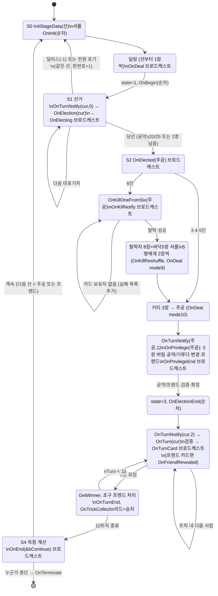

# 03. 게임 진행 FSM 과 AI 플러그인 인터페이스 (Mighty Network 3.2)

대상: `Mighty.exe` (MFC, 32-bit), `Xiao.dll`, `Ghost.dll` — Ghidra 디컴파일 결과(`re/decompiled/*.annotated.c`)와
원본 바이너리(마이티 네트워크 3.2 배포본의 Mighty.exe, Xiao.dll, Ghost.dll)의 vtable/디스어셈블을 함께 확인했다.
주소는 모두 VA. `FUN_xxxxxxxx` 는 Ghidra 이름이다. "확인됨" 표시가 없는 해석 중 의심스러운 것은 마지막
"불확실한 부분" 에 모아 두었다.

---

## 0. 요약

- 게임 진행은 `CMFSM` (RTTI `.PAVCMFSM@@`, vtable `0x00438c88`, `CState` 상속, 크기 0x204) 의
  **전용 스레드 하나가 순차 코드로 실행**한다. 본체는 `FUN_004225b0` (무한 루프, 한 판 = 한 바퀴).
  "상태"는 `CState+0x04` 정수(0 딜링 / 1 선거 / 2 주공 재정비 / 3 플레이 / 4 종료)일 뿐이고, 실제 흐름은 코드 순서다.
- 모든 참가자(사람/AI/네트워크)는 `CPlayer` 기반 클래스(vtable `0x00438f40`, 25개 가상함수)로 추상화된다.
  FSM 은 `player->OnXxx(args..., CEvent* e)` 를 호출하고 **플레이어가 `e` 를 Set 할 때까지 기다린다**
  (비동기 요청/응답). 브로드캐스트(통지)는 모든 플레이어에게 동시에 호출하고 전원 응답을 기다린다.
- AI DLL 은 `MaiGetInfo / MaiGetPlay / MaiOption / MaiReleasePlay` 를 export 하고, `MaiGetPlay` 가
  `CPlay` 객체(가상함수 8개: dtor + 7개)를 반환한다. `CPlayer`(AI) 가 FSM 콜백을 `CPlay` 로 위임한다.
  AI 는 export 된 `CState`/`CCard`/`CCardList` (Mighty.exe export) 를 통해 **게임 상태 전체**를 읽는다.
- 내장 AI "BSW" = *'검은 양떼 벽'(Black Sheep Wall) 알고리즘 V2.17* (`0x4422f0`): 모든 패를 보고 벌점 테이블 +
  탐욕/종반 완전탐색. Xiao: 공약/버릴카드는 BSW 와 동일 평가함수 복사본, 카드 플레이는 확률 추론.
  Ghost: 공약 안 함 + 합법 카드 중 랜덤 (최소 구현 예제로 매우 유용).

---

## 1. 기본 데이터 표현

### 1.1 카드 (`CCard` = int 하나) — 확인됨 (`CCard::GetShape @004012b0`, `GetNum @004012e0`, 카드 이름 문자열 테이블)

| 값 | 의미 |
|---|---|
| 0 | 없음(Nothing) |
| 1..52 | `shape = (c-1)/13+1`, `num = (c-1)%13+1` |
| 53 (0x35) | 조커 |

- shape: **1=♠ 스페이드, 2=◆ 다이아몬드, 3=♥ 하트, 4=♣ 클로버** (문자열 테이블 `스페이드A..`, `다이아몬드A..`, `클로버A..` 순서 및 프리셋 해석으로 확인).
- num: 1=A, 2..10, 11=J, 12=Q, 13=K. 세기(`GetPowerNum @00401300`): 2→1 … K→12, A→13, 조커/없음→14.
- 점수카드(`IsPoint @00401370`): 10, J, Q, K, A (총 20장).
- 마이티(`GetMighty @0040aa80`): 규칙 `rule+0x38`(기본 ♠A=1), 기루다가 그 무늬면 `rule+0x3c`(기본 ◆A=14).
- 조커콜(`GetJokercall @0040ab10`): `rule+0x40`(기본 ♣3=42), 기루다가 그 무늬면 `rule+0x44`(기본 ♠3=3; 관악/경기 프리셋은 ♥3=29).
- 원아이드잭(`IsOneEyedJack`): ♠J, ♥J.

### 1.2 기루다 / 공약(CGoal) — 확인됨 (Ghost `OnElected`, FSM, 사람 UI)

```c
struct CGoal {          // 12 bytes, FSM 지역변수 local_38/34/30, CState+0xc8/0xcc/0xd0 과 동일 배치
  int nKiruda;          // 0 = 노기루다, 1..4 = 무늬
  int nMinScore;        // 목표 점수(장수). 0 = 출마 포기(pass), -1 = 딜미스 선언(또는 AI의 "포기")
  int nFriend;          // 아래 참조
};
```
`nFriend`: `0` = 노프렌드, `100` = 초구 프렌드(첫 트릭 승자), `<0` = 플레이어 프렌드(`-1 - 플레이어번호`),
`1..53` = 카드 프렌드(그 카드를 가진 사람). 검증: `CState::GetValidFriend @00431ac0`
(규칙 `rule+0x13`=프렌드 허용이 꺼져 있으면 항상 0, 조커 프렌드는 `rule+0x14` 필요, 주공 손패 또는 버린 카드에 있는 카드는 불가).

### 1.3 규칙(CRule, 0x48 bytes, `CState+0x08`) — 인코딩 확인됨 (`FUN_00430a10` decode, `FUN_004306a0` encode)

14글자 문자열: 각 문자 −0x23. 문자 0..5 = int 필드 `+0x00 인원수, +0x08 최소공약, +0x38 마이티, +0x3c 대체마이티,
+0x40 조커콜, +0x44 대체조커콜`; 문자 6..13 = 비트필드(문자6: `+0xc,+0xd,+0x4,+0xe,+0xf,+0x10`, 문자7..13: `+0x11..+0x37` 순서대로 6비트씩).
프리셋 표(`PTR_DAT_00442e5c`, 12개)를 디코드한 값:

| 프리셋 | 인원 | 최소공약 | 비고 |
|---|---|---|---|
| 표준 5마 / 표준 6마 | 5 / 6 | 13 | |
| 표준 4마 | 4 | 14 | 프렌드 허용, 조커프렌드 불가 |
| 표준 3마 | 3 | 12 | 프렌드 없음(`+0x13`=0) |
| 신촌 5마 14, 경기 5마 12, 대구/광주 5마 12, 부산 4마 13, 관악/대전 6마 13, 제주 3마 12 | | | 지역별 플래그 차이 |

코드에서 의미가 확인된 플래그(나머지는 "불확실한 부분"):

| 오프셋 | 의미 (사용처) |
|---|---|
| +0x0c | 노기루다면 최소공약 −1 (`IsValidNewGoal`) |
| +0x0d | 최대 공약 25 (아니면 20) (`IsValidNewGoal`, `FUN_00420d10`) |
| +0x0e | 다음 판 선(先) = 프렌드 (아니면 주공) (`FUN_004225b0` 끝) |
| +0x0f | 선이 첫 차례에 포기 가능 ("선은 첫 턴에 반드시 출마하여야 합니다") |
| +0x10/+0x11 | 당선 후 기루다 변경 시 공약 +2 요구 / 노기루다 관련이면 +1 |
| +0x13 | 프렌드 허용, +0x14 조커 프렌드 허용 |
| +0x15 | 주공이 받는 키티를 공개 (사람 UI `FUN_004278e0`), 점수 계산에서 버린 카드 점수 제외(`FUN_00421240`) |
| +0x16/+0x18 | 첫/마지막 트릭에 마이티 낼 수 있음 (`GetAvList`) |
| +0x17/+0x19 | 첫/마지막 트릭에서 마이티가 이김 (`PowerComp`) |
| +0x1a | 조커콜 시 조커 대신 마이티 가능 |
| +0x1b/+0x1d | 첫/마지막 트릭에 조커 낼 수 있음 |
| +0x1c/+0x1e | 첫/마지막 트릭에서 조커가 이김 |
| +0x1f/+0x20 | 첫 트릭에 기루다: 무늬가 없을 때 낼 수 있음 / 선(리드)으로 낼 수 있음 |
| +0x21 | 첫 트릭에서도 조커콜 유효 (`IsEffectiveJokercall`, `GetAvList`) |
| +0x22 | 조커콜 당해도 조커가 힘을 유지(?) (`PowerComp`) |
| +0x25..+0x2a | 딜미스 판정 세부 (§2.4) |
| +0x2b..+0x2e | 득점(돈) 계산식 선택 (§2.9) |
| +0x30/+0x31/+0x32/+0x35 | 런 x2 / 20공약일 때만 런 x2 / 빽런 x2 / 런이면 고정 20 |

### 1.4 덱 구성 (`CCardList::NewDeck @0040b340`) — 확인됨
- 5·6인: 53장 전체. 6인은 1인 8장 → 48장 + 바닥 5장.
- 4인: 53장에서 2~9 중 낮은 카드 10장 제거(조커콜·대체조커콜 카드는 남김) → 43장(10×4+3).
- 3인: 2~9 중 5개 숫자(조커콜 숫자 제외) 20장 제거 → 33장(10×3+3).
- `InitStageData` 에서 `Suffle()` 를 4번 호출(`@004315b0`).

---

## 2. 게임 진행 FSM

### 2.1 구조

- `CMFSM` 생성자 `FUN_004205d0(this, char* ruleString, CPlayer** apPlayers, CNetwork* pNet)`.
  게임 시작부: 싱글 `FUN_0041b250`(사람 1 + AI n−1), 네트워크 서버 `FUN_004104a0`, 클라이언트 `FUN_00410890`.
- 시작 `FUN_00421df0(this, nLocalSeatOffset)`: `InitStageData(0,0)` → AI 작업 스레드(`FUN_00421bb0`, `FUN_00421cf0`) →
  FSM 스레드(`AfxBeginThread(LAB_00421e40)` → `FUN_004225b0`).
- 동기화 프리미티브:
  - 플레이어별 manual-reset `CEvent` (`this+0x180[i]`). `FUN_00422370` = "요청 시작"(모든 플래그 `this+0x198[i]=1`, 이벤트 Reset, 대기 수 = 인원).
  - `FUN_004223e0` = `CMultiLock` 으로 플레이어 이벤트들 + FSM 메시지 이벤트(`+0x124`) 대기. 메시지 이벤트면
    `FUN_00421e80`(종료 요청, 채팅 큐 처리 → 전원 `OnChat`) 후 계속 대기. 반환값 = 응답한 플레이어.
  - 패턴 A **단일 요청**: `player[i]->Vfn(..., e_i)` 후 i 가 응답할 때까지 대기 (예: 공약, 카드 내기).
  - 패턴 B **브로드캐스트 통지**: 전원 `Vfn(..., e_i)` 호출 후 전원 응답까지 대기 (애니메이션/표시 동기화 지점).
  - 패턴 C **순차 통지**: i=0..n−1 각각 단일 요청 (예: `OnInit`, `OnBegin`, `OnElectionEnd`).
- 종료: 플레이어가 `OnEnd` 에서 계속=false 를 주거나 중단 요청(`+0x12c/+0x12e`) 시 전원 `OnTerminate(msg)` 후
  C++ 예외(`_CxxThrowException(&DAT_0043ce08)`)로 스레드 탈출.

### 2.2 CState / CMFSM 필드 (확인된 것)

| 오프셋 | 이름(추정) | 설명 |
|---|---|---|
| +0x04 | nState | 0 초기/딜링, 1 선거, 2 주공 재정비, 3 플레이, 4 종료 |
| +0x08 | pRule | CRule* |
| +0x0c | nGame | 판 번호 ("제 %d 대 대선", 1이면 "초대 선거") |
| +0x10[6] | apAllPlayers | 좌석(절대 번호)순 CPlayer* |
| +0x28 | plDeck | 덱 → 딜 후 바닥(키티) → 버린 카드 + 여당이 딴 점수카드 더미 |
| +0x2c | plCurrent | 현재 트릭에 깔린 카드 (리드부터 순서대로) |
| +0x30[6] | anPoint | 플레이어별 딴 점수카드 수 |
| +0x48[6], +0x60[6], +0x78[6] | 통계 | 도움/실점/선 횟수 (`WriteHistory @004317d0`) |
| +0x90[6] | apPlayers | 현재 게임 순서(6마 탈락 후 5명) |
| +0xa8 | nPlayers | 현재 인원 |
| +0xac[6] | abGiveup | 선거 포기 여부 |
| +0xb4 | plKillFailed | 6마: 실패한 탈락 지목 카드들 |
| +0xb8 | nMaster | 주공 |
| +0xbc | nFriend | 프렌드 (−1 없음, −2 초구 미정) |
| +0xc0 | nKilled | 6마 탈락자(원래 좌석 기준) |
| +0xc4 | bFriendRevealed | |
| +0xc8/+0xcc/+0xd0 | goal | 현재 CGoal (기루다/공약/프렌드 지정) |
| +0xe0 | nDropPoint | 주공이 버린 3장의 점수카드 수 |
| +0xe4 | bJokerUsed | |
| +0xe8[4] / +0xf8[4] | 낸 카드 비트마스크(무늬별) | 확정 / 현재 트릭 |
| +0x108 | nTurn | 트릭 번호 0..9 |
| +0x10c | nBeginer | 이번 트릭의 리드(선). 판 시작 시 선 |
| +0x110 | bJokercall | 이번 트릭 조커콜 선언됨 |
| +0x114 | nJokerShape | 조커 리드 시 지정 무늬(1..4) |
| +0x118 | cLast | 방금 처리한 카드 |
| +0x11c | nCurrentPlayer | 현재 차례 |
| CMFSM +0x120 | nSeatOffset | 로컬 좌석 회전(네트워크) |
| +0x174 | pNet | 네트워크 객체 (서버/클라이언트) |

### 2.3 한 판의 순서 (`FUN_004225b0`)

```
loop (한 판):
 S0 준비/딜링 (state=0)
   InitStageData(nGame+1, 선)            ; 덱 생성+셔플4회, 각종 초기화 (@004315b0)
   [네트워크 클라] FUN_00422210          ; 서버가 보낸 덱(msg 0x64)으로 교체
   순차: player[i].OnInit()               ; vt+0x38
   딜: k = 0 .. n*(n==6?8:10)-1
        카드 = deck.pop(); 받는이 = (선 + k) % n
        브로드캐스트 OnDeal(-1, 받는이, 1, 카드)   ; vt+0x3c (손패 2,5,8,10장 시점마다 동기화)
   → 나머지(5인 3장, 6인 5장)는 deck(+0x28)에 남음 = 키티
 S1 선거 (state=1)
   순차: OnBegin(pState)                  ; vt+0x10
   cur = 선
   repeat:
     브로드캐스트 OnTurnNotify(cur, 0)    ; vt+0x58 ("님의 공약 결정 중")
     goal = 현재 최고공약 복사; player[cur].OnElection(&goal)   ; vt+0x1c  ★사용자 입력
     검증 IsValidNewGoal(kiruda,min): 실패 → min=0(포기)로 재검증 → 그것도 실패(선의 첫 턴 포기 불가)면
          강제로 (노기루다, 규칙 최소공약)
     브로드캐스트 OnElecting(cur, kiruda, min)   ; vt+0x40
     FUN_00420d10 으로 다음 사람/종료 판정 (§2.5)
       - 딜미스(-1) 또는 전원 포기 → state=4, S0 로 (같은 선으로 재딜)
       - 포기면 abGiveup[cur]=1, 아니면 현재 최고공약 갱신
     cur = 다음 사람
   until 당선자 결정
   nMaster = 당선자; state=2; 선 = 현재차례 = 주공
 S2 주공 재정비 (state=2)
   브로드캐스트 OnTurnNotify(주공,0); 손패 정렬; 브로드캐스트 OnElected(주공)   ; vt+0x20 "당선자가 확정되었습니다"
   [6인] 탈락 절차 (§2.6)
   키티 지급: deck 의 남은 카드 전부 주공 손패로, 장마다 브로드캐스트 OnDeal(-1,주공,10,카드)
   브로드캐스트 OnTurnNotify(주공, 1)     ; "님이 당을 재정비하고 있습니다"
   player[주공].OnPrivilege(&newGoal, acDrop[3])   ; vt+0x24 ★버릴 3장 + 기루다/공약 변경 + 프렌드 지정
   브로드캐스트 OnPrivilegeEnd(&newGoal, acDrop)   ; vt+0x48
   버린 카드 검증: 손패에 없는 카드면 손패에서 자동 선택; FUN_004210c0 로 3장을 deck 으로 이동,
     nDropPoint 계산, 기루다 적용, 손패 재정렬
   IsValidNewGoal 실패 시 선거 때 공약으로 복귀; 프렌드는 GetValidFriend 로 검증
   프렌드 확정: 0→nFriend=-1,공개 / 100→nFriend=-2(초구) / <0→플레이어,공개 /
               카드→그 카드 가진 사람(비공개), 아무도 없으면 -1·공개
 S3 플레이 (state=3)
   순차: OnElectionEnd()                   ; vt+0x28 "-- 선거 결과 발표 --" (공약/프렌드 표시)
   for nTurn = 0..9:
     nJokerShape=0, bJokercall=false
     for k = 0..n-1:  cur = (nBeginer + k) % n
       브로드캐스트 OnTurnNotify(cur, 2)  ; " 님 차례입니다"
       player[cur].OnTurn(&card, &eff)     ; vt+0x30 ★사용자 입력
       GetAvList 로 합법성 검사, 불법이면 합법 목록 첫 카드·eff=0 으로 대체
       FUN_004211c0: 조커콜이면 bJokercall = (eff!=0) (IsEffectiveJokercall 일 때만)
                     조커 리드면 nJokerShape = eff(1..4, 범위 밖이면 1), bJokerUsed=1
       손패→현재트릭 이동, 낸 카드 비트 기록
       카드 프렌드의 카드면: 프렌드 공개, 프렌드가 그동안 딴 점수카드(+0x68)를 여당 더미로 이동
       브로드캐스트 OnTurnCard(card, eff, ...)     ; vt+0x2c
       프렌드 공개됐으면 브로드캐스트 OnFriendRevealed(nFriend)   ; vt+0x50
     winner = CState::GetWinner(현재트릭)
     초구 프렌드(-2)면 winner 가 프렌드(주공이면 노프렌드: "주공이 초구가 되어서 노프렌드로 진행합니다"),
       공개 + 브로드캐스트 OnFriendRevealed
     WriteHistory(); 브로드캐스트 OnTurnEnd()     ; vt+0x34
     트릭 카드 정리: 점수카드 && winner 가 야당(주공도, 공개된 프렌드도 아님)이면 winner 의 +0x68 더미,
       아니면 deck 더미; 장마다 브로드캐스트 OnTrickCollect(winner)   ; vt+0x4c
     nBeginer = winner
 S4 종료 (state=4)
   FUN_00421240 으로 승패·돈 계산 (§2.9), 통산 전적 갱신
   브로드캐스트 OnEnd(&bContinue)          ; vt+0x54 ★"게임 끝" 확인
   누군가 false → 전원 OnTerminate, 스레드 종료
   다음 선 = (rule+0x0e && 프렌드≥0) ? 프렌드 : 주공  → loop
```

### 2.4 딜미스 (`CState::IsDealMiss @00431b80`)

선거 단계(state==1)에서 `minScore == -1` 공약은 `IsDealMiss(손패)` 가 참일 때만 유효(`IsValidNewGoal @00431940`).
판정(p = 손패 점수카드 수):
1. `rule+0x27` 이면 p −= 1 (의미 불확실).
2. `rule+0x2a` && 마이티 보유 && p==1 → 딜미스.
3. `rule+0x28` && p==1 && 손패에 10 있음 → 딜미스.
4. `rule+0x29` && p==1 && 원아이드잭(♠J/♥J) 보유 → 딜미스.
5. 조커 보유 && `rule+0x26` → p+=1; 마이티 보유 && !`rule+0x25` → p−=1.
6. p < 1 → 딜미스; 그 외 `손패장수 <= p` 면 딜미스.

딜미스 선언 → `FUN_00420d10` 가 재딜 플래그 → 같은 선으로 S0 재시작 (판 번호는 증가).
사람 UI: 선거 대화상자(`FUN_00411110`)가 딜미스 가능하면 "딜미스 !!" 버튼 활성화.

### 2.5 선거 진행 규칙 (`FUN_00420d10`, `IsValidNewGoal`)

- 순서: 선부터 시계방향(인덱스 +1), 포기한 사람은 건너뜀.
- 공약 유효성(`IsValidNewGoal`, state==1): `최소공약(노기루다+rule0x0c면 −1) <= min <= 20(rule0x0d면 25)` 그리고
  `min > 현재 최고공약`. 포기(0)는 "아무도 출마 안 했고 현재=선이며 !rule+0x0f" 일 때만 불가.
- 즉시 당선: `min >= 20`(rule0x0d면 `>=25`) 이거나 출마자 외 남은(미포기) 사람이 없을 때.
- 포기 처리: 다음 미포기자를 찾음. 아무도 없으면 **전원 포기 → 재딜**. 남은 미포기자가 한 명뿐이고
  현재 공약이 존재하면 그 사람이 당선.
- state==2(주공 재정비)에서 공약 변경: 같은 기루다면 `min >= 기존`, 기루다 변경이면 `min >= 기존 + d`
  (d=2, 단 `!rule0x10` 또는 (`rule0x11` 이고 변경 전/후 노기루다) 이면 d=1; 손패 ≤12장인 경우도 1). 상한 동일.

UI 메시지(사람): "공약을 정해 주세요", "목표점수를 더 올려야 합니다", "이 공약으로는 출마할 수 없습니다",
"선은 첫 턴에 반드시 출마하여야 합니다", "출마 !!", "포기", "딜미스 !!", "당선을 축하드립니다 !!".

### 2.6 6인(6마) 탈락 절차 (FSM 내 `if (*rule == 6)` 블록) — 확인됨

1. 주공에게 `OnKillOneFromSix(&card, plKillFailed)` (vt+0x18) ★ "다음의 카드를 가진 플레이어를 탈락시킵니다".
2. `FUN_00420cb0`: 주공 이외에서 그 카드 보유자 검색. 없으면(바닥/주공 손패) 실패 목록(+0xb4)에 추가.
3. 브로드캐스트 `OnKillNotify(card, bKilled)` (vt+0x14). 실패면 "그러나 해당 카드를 가진 플레이어가 없습니다 /
   다시 카드를 선택합니다" 후 1 로.
4. 성공: 탈락자 손패 8장을 deck 으로(장마다 `OnDeal(탈락자,-1,3,card)`), `FUN_00420b70` 으로 탈락자 제외·
   인덱스 재계산(nPlayers=5), deck(키티 5 + 8 = 13장) 셔플, [네트워크] 서버 덱 동기화(msg 0x67),
   브로드캐스트 vt+0x44 (`OnKillReshuffle`), `OnDeal(-1,-1,0,0)`(리셋).
5. 13장 중 10장을 선부터 한 장씩 5명에게 재분배(`OnDeal(-1,받는이,9,card)`) → 각 10장, 남은 3장이 키티.
6. 이후 5인 게임과 동일(키티는 주공에게).

### 2.7 3·4인

FSM 코드는 인원수만 다르고 동일 흐름(1인 10장, 키티 3장). 차이는 덱 구성(§1.4)과 규칙 프리셋
(3마 표준은 프렌드 없음 → 득점 분배 시 주공 단독).

### 2.8 트릭 규칙 (`CCardList::GetAvList @0040c160`, `PowerComp @0040bea0`, `GetWinner @0040bde0`)

합법 카드(`GetAvList(hand, out, trick, nTurn, nJokerShape, bJokercall)`):
- 리드 무늬 = 첫 카드 무늬(조커 리드면 지정 무늬). 리드 무늬 카드가 있으면 그 무늬만(마이티·조커는 예외로 항상 후보).
- 마이티: 첫 트릭은 `rule+0x16`, 마지막 트릭은 `rule+0x18` 일 때만 후보.
- 조커: 첫/마지막 트릭은 `rule+0x1b`/`+0x1d`. **조커콜이 리드되고 유효하면(nTurn≠0 또는 rule+0x21) 조커를 반드시**
  (rule+0x1a 면 마이티로 대신 가능).
- 첫 트릭 기루다: `rule+0x1f` 없으면 불가; 있으면 따라갈 때는 가능, 리드는 `rule+0x20`.
- nTurn==7: 마이티·조커 둘 다 있고 둘 다 마지막 트릭 금지면 둘 중 하나 강제. nTurn==8: 금지된 마이티(또는 조커) 강제.
- 후보가 비면 손패 전체.

승자(`PowerComp`): 마이티(유효 시) > 조커(유효 시; 첫/마지막 트릭은 rule+0x1c/+0x1e, 조커콜 당하면 무력
(rule+0x22 예외)) > 기루다 > 리드 무늬 > 기타. 같은 무늬는 A>K>…>2. 조커가 무력이면 최하위.
조커콜 유효(`IsEffectiveJokercall @00431dd0`): (nTurn≠0 또는 rule+0x21) && 조커 미사용 && 리드일 때.

### 2.9 득점 계산 (`FUN_00421240`)

- 여당 득점 = Σ(주공·프렌드의 anPoint) + (rule+0x15 가 아니면 nDropPoint). 승리 = 득점 ≥ min(공약,20).
- 기본 점수 S (패배 시 `공약 − 득점`), 승리 시 규칙별:
  `rule+0x2b`: `(공약−최소)×2 + (득점−공약)`; `+0x2c`: `득점−공약`; `+0x2d`: `득점−공약+1`; `+0x2e`: `득점−10`;
  기본: `득점 − 최소공약`. (표시 문자열 `((%d-%d)x2+(%d-%d))`, `(%d-%d)`, `(%d-%d+1)`, `(%d-10)` @004423e8..)
- 배수: 런(득점 20) x2(rule+0x30, 또는 +0x31 이면 공약 20일 때만), +0x35 면 고정 20; 빽런 x2(+0x32, 패배 시);
  승리 시 노기루다 x2, 프렌드 허용 규칙에서 노프렌드 x2.
- 돈 이동: 야당 각자 ∓S. 합계를 주공/프렌드가 나눔 — 프렌드가 있으면 주공 (n−3)/(n−2), 프렌드 나머지
  (5인: 주공 2/3, 프렌드 1/3), 없으면 주공 전부. 음수 잔액은 0으로 자르고 나머지에게 재분배.
- 통산 전적: CPlayer +0x14..+0x28 (주공승/패, 프렌드승/패, 야당패/승), +0x2c..+0x40 동일(세션).

### 2.10 FSM 상태도



### 2.11 웹 클라이언트에 필요한 사용자 상호작용(★)

| 시점 | 콜백 | 입력 | 원본 UI |
|---|---|---|---|
| 선거 | OnElection | 기루다(노기루다/4무늬) + 공약 숫자, 또는 포기 / 딜미스 | `FUN_00411110(mode 0)` 대화상자 |
| 6마 탈락 | OnKillOneFromSix | 카드 1장 지정 (실패 시 재지정) | `FUN_00411e40` "원하는 표적 카드를 아래에서 선택" |
| 주공 재정비 | OnPrivilege | 버릴 3장 선택 → 기루다/공약 변경(선택) → 프렌드(카드/플레이어/초구/노프렌드) | `FUN_00411110(mode 1)` + `FUN_00413370` "프랜드를 선택합니다" |
| 카드 내기 | OnTurn | 카드 1장 + 조커 리드 시 무늬 / 조커콜 시 "조커 콜 / 콜 아님" | 보드 클릭 |
| 판 끝 | OnEnd | 계속/그만 | 점수판 `FUN_004159b0` |

사람 플레이어는 이 외 통지에서도 애니메이션 동안 이벤트 Set 을 지연시킨다(`Sleep(speed*400+500)` 등).
웹 버전은 서버측 FSM 을 async/await 로 그대로 옮기고, 통지는 "전원 ack(타임아웃 포함)" 로 구현하면 원본 타이밍과 동일하다.

---

## 3. 플레이어 추상화 (`CPlayer`)

### 3.1 클래스와 vtable

| 클래스 | vtable | 생성자 | 크기 |
|---|---|---|---|
| CPlayer (기반) | `0x00438f40` | (인라인) | – |
| 사람 CPlayerHuman | `0x00438edc` | `FUN_004266b0` | 0xc0 |
| AI CPlayerMai | `0x004390a8` | `FUN_00429570` | 0xb0 |
| 네트워크 원격 CPlayerNetwork | `0x00439130` | `FUN_0042a2c0` | 0x94 |

CPlayer 필드: `+0x04` 좌석 ID, `+0x08` 게임 내 순번(탈락 시 −1), `+0x0c` 돈(비자금, 판 시작 100), `+0x10` 이전 돈,
`+0x14..+0x40` 전적, `+0x44` 이름(CString), `+0x4c` 손패 CCardList, `+0x68` 딴 점수카드 CCardList,
`+0x84` CMFSM*, `+0x88` CPlay*(AI; 사람도 힌트용으로 가질 수 있음).

### 3.2 가상함수 표 (마지막 인자 `CEvent* e` 는 완료 시 Set; 기반 구현은 `+0x88` 의 CPlay 로 위임 후 `SetEvent`)

| off | 이름(제안) | 인자 (e 제외) | FSM 호출 패턴 | 기반 구현 | 사람 | AI | 네트워크 |
|---|---|---|---|---|---|---|---|
| 0x00 | ~CPlayer | | | 004269c0 | 00426b10 | 004296c0 | 0042a3c0 |
| 0x04 | IsHuman | → bool | | false | **true** | false | false |
| 0x08 | IsComputer | → bool | | false | false | **true** | false |
| 0x0c | IsNetwork | → bool | | false | false | false | **true** |
| 0x10 | OnBegin | const CState* | 순차 | CPlay::OnBegin | 00427a80 | 기반 | 기반 |
| 0x14 | OnKillNotify | CCard c, bool bKilled | 브로드캐스트 | Set | 00427cc0 | 기반 | 0042aa40 |
| 0x18 | OnKillOneFromSix | CCard* pc, CCardList* plFailed | 단일(주공) | CPlay::OnKillOneFromSix | 00427bf0 | 00429cb0 | 0042a910 |
| 0x1c | OnElection | CGoal* pGoal | 단일 | CPlay::OnElection | 00427f20 | 00429dd0 | 0042a700 |
| 0x20 | OnElected | int nMaster | 브로드캐스트 | Set | 00428130 | 기반 | 기반 |
| 0x24 | OnPrivilege | CGoal* pGoal, CCard acDrop[3] | 단일(주공) | CPlay::OnElected | 00428440 | 기반 | 0042aba0 |
| 0x28 | OnElectionEnd | – | 순차 | CPlay::OnElectionEnd | 00428730 | 기반 | 기반 |
| 0x2c | OnTurnCard | CCard c, int eff, int ? | 브로드캐스트 | Set | 00428bd0 | 기반 | 0042b000 |
| 0x30 | OnTurn | CCard* pc, int* peff | 단일 | CPlay::OnTurn | 00428b40 | 00429ec0 | 0042aec0 |
| 0x34 | OnTurnEnd | – | 브로드캐스트 | CPlay::OnTurnEnd | 00428f70 | 기반 | 기반 |
| 0x38 | OnInit | – | 순차(판 시작) | Set | 00427790 | 기반 | 0042a670 |
| 0x3c | OnDeal | int from, int to, int mode, int card | 브로드캐스트 | Set | 004278e0 | 기반 | 기반 |
| 0x40 | OnElecting | int player, int kiruda, int min | 브로드캐스트 | Set | 00427fa0 | 기반 | 0042a850 |
| 0x44 | OnKillReshuffle | – | 브로드캐스트 | Set | 기반 | 기반 | 0042ab10 |
| 0x48 | OnPrivilegeEnd | CGoal*, CCard acDrop[3] | 브로드캐스트 | Set | 기반 | 기반 | 0042ada0 |
| 0x4c | OnTrickCollect | int winner | 브로드캐스트(카드마다) | Set | 00428c90 | 기반 | 기반 |
| 0x50 | OnFriendRevealed | int nFriend | 브로드캐스트 | Set | 00428fa0 | 기반 | 기반 |
| 0x54 | OnEnd | bool* pbContinue | 브로드캐스트 | *p=true; Set | 00429110 | 기반 | 기반 |
| 0x58 | OnTurnNotify | int player, int mode(0 공약/1 재정비/2 차례) | 브로드캐스트 | Set | 00429290 | 기반 | 기반 |
| 0x5c | OnTerminate | LPCTSTR reason | 직접(대기 없음) | 없음 | 00429380 | 기반 | 기반 |
| 0x60 | OnChat | int player, LPCTSTR msg, bool | 직접(대기 없음) | 없음 | 00429450 | 기반 | 0042b0d0 |

`OnDeal` mode: 0 리셋, 1 일반 딜, 3 탈락자 카드 회수, 9 6마 재분배, 10 키티→주공.
AI 플레이어(`00429cb0/00429dd0/00429ec0`)는 무거운 결정을 AI 작업 스레드(`FUN_00421bf0` → `FUN_00421c60`, mode 0=OnElection,
1=OnKillOneFromSix, 2=OnTurn)에서 돌리고, 최소 지연(옵션 속도 기반, 최대 5초)을 둔 뒤 이벤트를 Set 한다.

### 3.3 네트워크

원격 플레이어 프록시는 서버로부터 메시지를 받아 응답을 채운다 (`FUN_00431000` 수신, `FUN_00425330` 정수 파싱):
`0x64` 판 시작 덱, `0x65` 공약(player,kiruda,min,friend), `0x66` 탈락 카드, `0x67` 6마 재셔플 덱,
`0x68` 재정비(goal + 버린 3장, 포맷 `"llllllll"`), `0x69` 카드(card, eff), `10000` 원격 함수호출(`FUN_004204c0`).
FSM 은 네트워크 여부와 무관하게 동일하다(서버·클라 모두 같은 FSM 을 돌리고 결정만 주고받는 lock-step).

---

## 4. AI DLL 인터페이스

### 4.1 Export (확인됨: Xiao/Ghost export, Mighty 로더)

```c
// 정보: info[0] = 이름, info[1] = 설명 (CString[2])
void  __cdecl MaiGetInfo(CString* info);
// AI 인스턴스 생성. pszOption = 저장된 옵션 문자열(없으면 NULL), pCallback = 진행표시 콜백
CPlay* __cdecl MaiGetPlay(const char* pszOption, CMaiCallback* pCallback);
// 옵션 대화상자 (pPlay 의 옵션을 수정)
void  __cdecl MaiOption(CPlay* pPlay, HWND hParent);
// 해제 + 현재 옵션 문자열 반환
void  __cdecl MaiReleasePlay(CPlay* pPlay, CString* pOutOption);
```

- 게임 로더 `FUN_004297d0` (CPlayerMai): `LoadLibraryA` → `MaiGetInfo`, `MaiGetPlay`, **`MaiGetOption`**(선택),
  `MaiReleasePlay` 를 `+0x8c..+0x98` 에 저장, 필수는 Info/GetPlay/ReleasePlay. DLL 은 경로별 refcount 캐시
  (`DAT_0044335c` 리스트, CS `DAT_00443338`). 해제 `FUN_00429aa0` (refcount 0 이면 FreeLibrary).
- 옵션 대화상자 로더 `0x00415460`: `MaiGetPlay` → **`MaiOption`**(없으면 "이 DLL 에는 설정할 옵션이 없습니다") → `MaiReleasePlay` 로 새 옵션 문자열 획득.
- 정보만 조회 `FUN_0042bd00`: 경로가 비면 내장 BSW 의 `MaiGetInfo`(`FUN_0041c8f0`).
- DLL 로드 실패 시 내장 AI 로 대체(`FUN_00429c50`): Info `0041c8f0`, GetPlay `0041c910`, Option `0041c980`, Release `0041c990`.
- AI 는 `Mighty.exe` 의 export (`CCard::*`, `CCardList::*`, `CState::*`, `CCard::s_pState`) 를 import 한다
  → 규칙 판정(`GetAvList`, `GetWinner`, `IsValidNewGoal`, `IsDealMiss` …)을 호스트 코드로 그대로 재사용.

### 4.2 `CMaiCallback` (호스트가 제공, CPlayerMai+0x9c, vtable `0x0043910c`)

| off | 구현 | 의미 |
|---|---|---|
| 0x00 | `00429470` | `SetProgress(int percent)` → 메인창 `WM 0x40d, wParam 4` (진행률) |
| 0x04 | `004294a0` | `SetStatus(LPCTSTR)` → `WM 0x40d, wParam 5` (상태바 문구) |

Xiao/BSW 는 공약 계산 루프에서 `cb->vt[0]` 를 호출한다.

### 4.3 `CPlay` (AI 가 구현, vtable 8칸) — 확인됨 (Xiao `0x10009280`, 기반 `0x100092a0` 은 purecall×7, Ghost `0x10002188`, BSW `0x00438958`)

```cpp
class CPlay {
public:
  virtual ~CPlay();
  virtual void OnBegin(const CState* pState) = 0;                         // +0x04 상태 포인터 보관(이후 계속 참조)
  virtual void OnElection(CGoal* pNewGoal) = 0;                            // +0x08 입력=현재 최고공약, 출력=내 공약
  virtual void OnKillOneFromSix(CCard* pcCardToKill,
                                CCardList* plcFailedCardsTillNow) = 0;     // +0x0c
  virtual void OnElected(CGoal* pNewGoal, CCard acDrop[3]) = 0;            // +0x10 주공 재정비(버릴 3장, 공약/프렌드)
  virtual void OnElectionEnd() = 0;                                        // +0x14 플레이 시작 직전
  virtual void OnTurn(CCard* pc, int* pEff) = 0;                           // +0x18 낼 카드, eff=조커무늬(1..4)/조커콜(1)
  virtual void OnTurnEnd() = 0;                                            // +0x1c 트릭 종료
};
```
CPlayer 와의 대응: `OnBegin`←0x10, `OnElection`←0x1c, `OnKillOneFromSix`←0x18, `OnElected`←0x24,
`OnElectionEnd`←0x28, `OnTurn`←0x30, `OnTurnEnd`←0x34. 그 밖의 통지(카드 낸 것 등)는 AI 에 전달되지 않으므로
AI 는 `CState`(현재 트릭 `+0x2c`, 낸카드 비트 `+0xe8`, 손패들 `+0x90[i]+0x4c` …)를 직접 읽어 추적한다.
`OnElection` 에서 `nMinScore = -1` 을 돌려주면 FSM 이 "딜미스 불가 → 포기" 로 처리하므로 AI 들은 이를 "포기"로 쓴다.

### 4.4 Ghost.dll (참조 구현, `'유령' 알고리즘`)

- `OnElection` (`100010e0`): 항상 `min = -1` (출마 안 함).
- `OnKillOneFromSix` (`100010f0`): 내 손패·실패목록에 없는 랜덤 카드.
- `OnElected` (`10001180`): 프렌드 = 마이티(내게 없으면) → 조커(규칙 허용·내게 없으면) → 노프렌드; 버릴 카드 = 손패 앞에서부터 마이티/조커가 아닌 3장.
- `OnTurn` (`10001270`): `GetAvList` 결과에서 랜덤; 조커면 eff = 랜덤 무늬 1..4, 조커콜이면 eff=1.

### 4.5 내장 BSW ('검은 양떼 벽' V2.17) — 클래스 vtable `0x00438958`, 생성 `FUN_0041f920`

설명문(`0x4421b8`) 요지: 미리 정의된 벌점 테이블로 가능한 모든 경우의 벌점을 계산해 최소 벌점 해를 고르는 탐욕
알고리즘이며 **다른 사람의 패를 모두 읽는다**. 옵션 문자열 `"%d %d %d"` = (점진 공약 bool `+0x14`, bool `+0x15`, int `+0x10`), 기본 `1 1 5`.

- 손패 평가 `FUN_0041d4c0(kiruda, hand)` — 가중치 테이블 `FUN_0041d460`
  `[1500,300,350,100,40,30,50,60,70,80,30,100,200,100]`:
  - 마이티 보유 +W[11], 조커 보유 +W[12](조건부 W[13]).
  - 기루다 비율 ≥60% → +W[1](300), 40~60% 선형; 비율≥40% 이고 그 무늬가 최다 무늬면 +W[0](1500).
  - 기루다 A/K/Q/J 없음 → −350 / −100 / −(100+40) / −(…+30) 누적 감점.
  - 비기루다 무늬: 각 무늬의 최상위 연속 카드 이후 "질 카드"를 세어 (상위와의 간격 1/2/3 → −50/−60/−70, 그 외 소폭)
    감점, 빈 무늬(void)마다 +30. 노기루다는 이 값×3 + 300 + 1500.
  - 손패 8장(6마 단계)은 ×10/8 보정.
- 공약 `FUN_0041dd90`: 기루다 0..4 각각에 대해 (손패+키티 13장이면 버릴 3장의 모든 조합 중 최대) 평가값 → 최댓값의
  기루다 선택, `FUN_0041dd00(eval)` ≈ `round(eval/100)` (보정 후, 최소공약−1이면 +1, 0..20 클램프).
  **선거 중에도 `pState+0x28`(아직 안 받은 키티)를 손패에 합쳐 평가**한다.
- OnElection(`0041fc30`): 규칙 최소공약 > 계산값 → −1(포기). 옵션 `+0x14`=0 이면 계산값 그대로, 1이면 현재 최고공약+1
  (아직 없으면 최소공약)로 한 단계씩 올림.
- OnElected(`0041fd10`): 같은 평가로 버릴 3장 결정, 프렌드 `FUN_0041e1c0`, 기루다가 바뀌면 `IsValidNewGoal` 을 만족하는
  가장 낮은 공약으로 변경.
- OnKillOneFromSix: `FUN_0041e3a0`.
- OnTurn(`0041fdb0` → `FUN_0041f820`): `nTurn + 2 (+옵션) < 10` 이면 `FUN_0041e8d0`(각 후보 카드에 대해 남은 사람들의
  **실제 손패**로 트릭을 시뮬레이션해 벌점 테이블 `FUN_0041ca20` 로 점수화, 최소 벌점), 아니면 `FUN_0041ef70` →
  재귀 `FUN_0041f150`(남은 트릭 전체 완전탐색, 완전정보 minimax). 특례: 주공이 리드하고 프렌드가 마이티이며 프렌드가
  조커를 갖고 있으면 조커콜 선언.
  벌점 테이블(24개): `500,-50,200,-20,100,-20,10,-1,1999,1997,1998,2000,300,200,350,1000,2500,5000,100000000,-400,-500,-3000,-5000,-100000000`
  (항목 의미는 미해석).

### 4.6 Xiao.dll ('확률 추론') — CPlay vtable `0x10009280`, 생성 `FUN_10001000`

구성: `this+0x8` CState*, `this+0xc` 추론기(0x290 B, `FUN_10005900`/`10005b60`), `this+0x10` 의사결정기(0x1c B,
가중치 테이블 `FUN_10001850` = BSW 와 **동일한 14개 값**), 옵션 `"%d %d %d"` 기본 `5 3 3` (의미 미상, 옵션 대화상자 `FUN_10001320`).

- OnBegin(`10001410`): pState 저장.
- OnElection(`10001420`): BSW 공약 함수의 복사본(`FUN_10002340` = `FUN_0041dd90`, `FUN_10002210` = `FUN_0041dd00`)으로
  (기루다, 목표) 계산 — **역시 키티(pState+0x28)를 포함해서 평가**(6인일 때는 키티 없이).
  목표 < 규칙 최소공약 → −1(포기); 목표−현재 == 2 → 목표로 점프; 현재 < 목표 && 현재>0 → 현재+1; 그 외 최소공약(무효면 FSM 이 포기로 처리).
- OnKillOneFromSix(`100014e0` → `FUN_10002950`): 기루다 무늬(노기루다면 전 무늬)에서 내 손패·실패목록에 없는 가장 높은 카드
  (A → K → Q … 3).
- OnElected(`10001510`): 버릴 3장 = 평가 최대 조합; 프렌드(`FUN_10002760`): 마이티(내게 없으면) → 조커(허용·없으면) →
  기루다 A → 기루다 K → 다른 무늬 A → 그래도 없으면 rand()%3 로 노프렌드/카드1/플레이어. 기루다를 바꿀 수 있으면
  기존공약..목표 중 `IsValidNewGoal` 을 만족하는 최소값으로 변경.
- OnElectionEnd(`100015c0` → `FUN_10005900`): 추론 초기화.
  - 카드 상태표(53칸): 2=내 카드, 3=남이 가짐(위치 모름), 1=현재 트릭, 0=사라짐. 키티는 주공 본인이 아니면 3.
  - 플레이어별 "여당일 확률" `+0x100+i*0x48`: 나 0, 주공 1, 나머지 1/(n−1) 또는 1/(n−2).
  - 플레이어×무늬 보유 가중치(double): 기본 1.0, 주공의 기루다 무늬 2.5, 주공의 다른 무늬 0.667, 나 자신 0.
- OnTurn(`100015e0`): `FUN_10005b60`(현재 트릭 반영) 후 `FUN_10002e30`(약 1000줄 규칙 기반):
  - 리드 무늬를 따르지 못한 플레이어는 해당 무늬 가중치 0 (`FUN_100063e0`), 낸 카드로 가중치 재정규화(`FUN_10006790`).
  - 현재 트릭 승자/여당 여부, 남은 상위 카드를 각 플레이어가 가질 확률(`FUN_10006060`, `FUN_10007130`)로 "이 카드가 이길
    확률"을 계산해 점수카드를 먹을지/버릴지 결정.
  - 주공이 리드이고 조커콜을 갖고 있으며 조커가 상대편에 있을 가능성이 높으면(`FUN_10007080`) 조커콜(eff=1).
  - 첫 트릭 조커 금지 규칙(`rule+0x1c`) 처리 등 규칙 플래그 참조.
- OnTurnEnd(`10001610`): `FUN_10005b60` 로 트릭 결과를 추론에 반영.

### 4.7 TypeScript 이식 시 권장 인터페이스

```ts
type Card = number;            // 0 none, 1..52, 53 joker  (shape=(c-1)/13+1: 1♠ 2◆ 3♥ 4♣)
interface Goal { kiruda: 0|1|2|3|4; min: number; friend: number }  // min 0=pass, -1=dealmiss/pass
interface MightyAI {
  onBegin(state: Readonly<GameState>, me: number): void;
  onElection(cur: Goal): Goal;
  onKillOneFromSix(failed: Card[]): Card;
  onElected(goal: Goal): { goal: Goal; drop: [Card, Card, Card] };
  onElectionEnd(): void;
  onTurn(): { card: Card; eff: number };   // eff: 조커 리드 무늬 1..4 / 조커콜 1
  onTurnEnd(): void;
}
```
GameState 는 `CState` 의 공개 필드(§2.2)만 노출하고, 공정한 AI 를 위해 타인 손패·키티는 숨겨야 한다
(BSW 는 의도적 치트, Xiao 도 선거 시 키티를 읽는다). 이식 순서 제안: Ghost(규칙 검증용) → BSW 평가함수 기반 공약/버리기 +
간단한 휴리스틱 카드 선택 → Xiao 식 무늬 보유 확률 추론.

---

## 5. 불확실한 부분

1. **CPlayer 가상함수 이름**은 원본 소스가 없으므로 동작으로 붙인 이름이다. 인자 개수는 기반 구현의 `ret N` 과 FSM 호출부
   push 로 확인했지만 `OnTurnCard`(0x2c) 의 세 번째 인자(손패 내 인덱스로 추정), `OnChat`(0x60) 의 bool, `OnDeal`(0x3c) 의
   from/to 의미 일부는 추정이다.
2. 규칙 플래그 중 `+0x04, +0x12, +0x23, +0x24, +0x2f, +0x33, +0x34, +0x36, +0x37` 등은 사용처를 찾지 못했다. 규칙 대화상자
   라벨은 도움말 파일(`MIGHTY.HLP`)에만 있는 듯하며 미분석. `+0x27`(딜미스에서 점수 −1), `+0x22`(조커콜 시 조커 효력),
   `+0x15`(키티 공개 ↔ 버린 카드 점수 처리) 의 의미는 코드상 동작만 기술했다.
3. 득점식(`FUN_00421240`)은 Ghidra 출력이 심하게 꼬여 있어 `rule+0x2c` 분기의 정확한 식, 빽런 조건(`공약 <= 여당 도움+득점`
   형태로 보임), 음수 잔액 재분배 세부는 재확인이 필요하다.
4. `IsValidNewGoal` 의 기루다 변경 비용에서 "state==2 && 주공 손패 ≤ 12장이면 1" 조건의 의도(버린 뒤 재호출 시?)가 불명.
5. FSM 은 `MaiGetOption` 을, 옵션 대화상자는 `MaiOption` 을 찾는다. Xiao/Ghost 는 `MaiOption` 만 export → 게임 중 `+0x94` 는
   항상 NULL(사용처도 없음). 버전 차이로 남은 흔적으로 보인다.
6. AI 작업 스레드 디스패처 `FUN_00421c60` 은 mode 0 일 때 `vt+8` 하나의 인자만 넘기고 mode 1/2 에서 `SetEvent(param_1[1])`
   (CPlay+4) 를 호출하는 것처럼 디컴파일되는데, 인자/핸들 해석이 어긋났을 가능성이 있다(동작상 문제는 없음).
7. Xiao 의 카드 선택 본체 `FUN_10002e30`, 추론 갱신 `FUN_10006790`, BSW 의 `FUN_0041e8d0`/`FUN_0041f150` 은 고수준 구조만
   파악했다. 벌점 테이블/가중치의 항목별 의미, Xiao 옵션 3개(기본 5,3,3)와 BSW 옵션 `+0x15`, `+0x10`(기본 5)의 의미는 미해석.
8. Xiao 추론 초기화가 모든 플레이어의 손패 리스트를 순회하는데, 기록하는 값이 "타인 카드=3(위치 불명)" 뿐이라 정보 누설은
   없는 것으로 판단했다(단, 디컴파일 일부가 깨져 있음). 반면 선거 단계에서 키티(`pState+0x28`)를 평가에 넣는 것은
   디스어셈블(`10001420`, `0041fc30`)로 확인된 사실이다.
9. 첫 판의 선은 좌석 0(호스트/사람). 이후 판의 선은 주공(또는 rule+0x0e 시 프렌드)이며, 딜미스·전원포기 재딜은 같은 선을 유지
   하는 것으로 읽힌다(`0x10c` 를 갱신하지 않음).
10. 시작 돈 100 은 `FUN_0041b250` 에서 `player+0x0c = 100` 설정으로 추정(통산 "비자금"/"지지율" 표시와의 관계 미확인).
